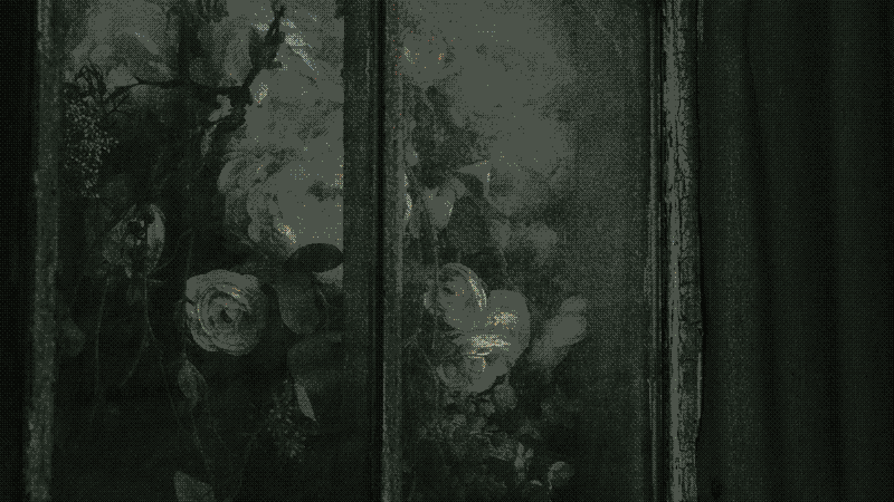

# Gothic Bit

A dark, dungeon-synth [Omarchy](https://omarchy.org) theme: moss-black glass, rusted window iron, and faded ivory roses.



## Install

```bash
omarchy theme install https://github.com/SpyrosGeo/omarchy-gothic-bit-theme
```

Reapply it later with:

```bash
omarchy theme set gothic-bit
```

## Wallpapers

All wallpapers live in `backgrounds/`. Cycle through them with:

```bash
omarchy theme bg next
```

## Included

- `colors.toml`: the full palette.
- `icons.theme`: `Yaru-sage-dark` icons.
- `backgrounds/`: three photos, pixelated and ordered-dithered to the theme palette.
- `preview.png`: the theme picker preview.

Omarchy generates the Hyprland, terminal, editor, and shell configs from `colors.toml`.

## Palette

| Role | Colour |
|------|--------|
| Background | `#0f130d` |
| Lighter background | `#1b231b` |
| Selection | `#2b332a` |
| Foreground | `#c8c9bb` |
| Accent | `#a8875a` |
| Red / Bright red | `#9a5a48` / `#b8735a` |
| Yellow / Bright yellow | `#b8a370` / `#d6c792` |
| Green / Bright green | `#7f9473` / `#9fb08f` |
| Cyan / Bright cyan | `#7a9a91` / `#9ab8ae` |
| Blue / Bright blue | `#6f8794` / `#8fa5b0` |
| Magenta / Bright magenta | `#8f7a86` / `#ab96a2` |

## Credits

- `gothic-bit-wallpaper.png`: photo by Jay Sekhar on [Unsplash](https://unsplash.com/photos/white-roses-behind-rusted-window-Z4DHyhDJmL0), pixel-dithered to the theme palette.
- `roger-ce-i2JcIcNzseY-unsplash.png`: photo by Roger Ce on [Unsplash](https://unsplash.com/photos/i2JcIcNzseY), pixel-dithered to the theme palette.
- `ruth-gledhill-1lHfs-Hqt1I-unsplash.png`: photo by Ruth Gledhill on [Unsplash](https://unsplash.com/photos/1lHfs-Hqt1I), pixel-dithered to the theme palette.
